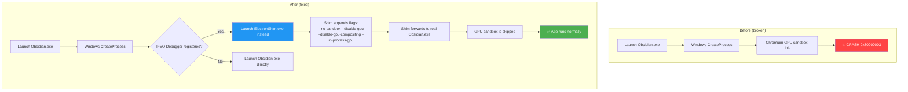
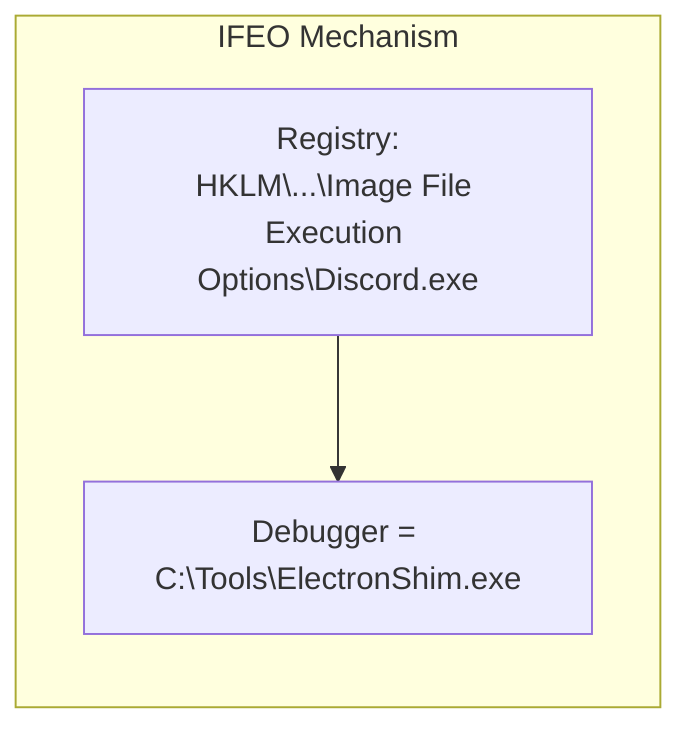

# Electron GPU Crash Fix — `0x80000003` (STATUS_BREAKPOINT)

[](LICENSE)
[](https://github.com/theyonecodes/electron-gpu-crash-fix)
[](https://github.com/theyonecodes/electron-gpu-crash-fix)
[](https://github.com/theyonecodes/toolkit)
[](https://github.com/theyonecodes/toolkit)
[](https://github.com/theyonecodes/toolkit)

> **Does Discord, Notion, Obsidian, VS Code, or any Electron-based app crash on launch with error `0x80000003` on your Windows machine?** You're not alone. This is a widespread issue on Windows 11 24H2/25H2 caused by a Chromium GPU sandbox regression. This repo gives you a **one-click, permanent, machine-wide fix** — no per-app shortcuts, no reinstalling drivers, no binary patching.

---

## 🚨 The Problem

### What users experience

```mermaid
flowchart TD
    A[Double-click Discord / Notion / Obsidian] --> B[Process appears in Task Manager]
    B --> C{GPU sandbox init}
    C -->|Fails| D[__debugbreak\(\) fires]
    D --> E[Process exits with 0x80000003]
    E --> F[No window, no error dialog, nothing]
    C -->|Succeeds| G[App runs normally]
    
    style D fill:#ff4444,color:#fff
    style E fill:#ff4444,color:#fff
    style F fill:#ff4444,color:#fff
    style G fill:#4caf50,color:#fff
```

Your app's process appears in Task Manager for a split second, then vanishes. No error window, no crash dialog — just silence. The Windows Event Log records:

```
Faulting process: Discord.exe
Exception code: 0x80000003 (STATUS_BREAKPOINT)
```

### Root cause

The Chromium GPU-process sandbox hits an internal assertion (`__debugbreak()`) during initialization on certain Windows 11 builds (24H2 / 25H2). The trigger lattice includes:

```mermaid
flowchart LR
    A[Windows 11 24H2+] --> B[Chromium GPU sandbox regression]
    C[NVIDIA + Intel iGPU coexistence] --> D[Phantom adapter in DACLs]
    E[NVIDIA Game Ready driver] --> F[vk_swiftshader path conflict]
    B --> G[__debugbreak\(\) → 0x80000003]
    D --> G
    F --> G
    
    style G fill:#ff4444,color:#fff
```

This affects **all Chromium-based desktop apps** — which today includes Discord, Notion, Obsidian, VS Code, Slack, Teams, Spotify, Signal, WhatsApp Desktop, Figma Desktop, Rekordbox, Upscayl, DaVinci Resolve, and thousands more.

---

## ✅ The Solution

### How the fix works



### The four flags

| Flag | What it does |
|------|-------------|
| `--no-sandbox` | Disables the Chromium GPU sandbox that causes the crash |
| `--disable-gpu` | Tells Chromium to skip GPU hardware acceleration entirely |
| `--disable-gpu-compositing` | Uses software compositing instead of GPU compositing |
| `--in-process-gpu` | Runs GPU processing in the main process (avoids sandbox init) |

These flags are injected **at OS level** via Windows `Image File Execution Options` (IFEO) — a built-in Windows mechanism originally designed for debuggers. The flow:



---

## 🆕 New in v2.0 — Toolkit Integration

| Feature | Description |
|---------|-------------|
| **🛡️ BackupEngine** | Every IFEO registration creates a timestamped registry backup with SHA-256 manifest + automatic rollback on failure |
| **🎨 DarkTheme GUI** | tkinter DarkTheme GUI (from CISO-Auditor) for app selection, dry-run, Jev triage, backup history |
| **🤖 Jev Router** | AI model routing with Choice/Score/Noul primitives — confidence scoring, guardrails, human review triggers |
| **🔄 ElectronShim (Rust)** | Rewritten in Rust via `theyonecodes/toolkit` for smaller, faster, safer binary |

---

## Quick Start

### 1. Build the Shim (Rust)
```cmd
# Requires Rust toolchain
cd src\electron-shim
cargo build --release --features electron-shim
# Output: target\release\electron-shim.exe
```

### 2. Run Installer (PowerShell)
```cmd
# One-shot install with backup protection
powershell -NoProfile -ExecutionPolicy Bypass -File installer\install-electron-ifeo-and-task.ps1

# With custom shim path
powershell -NoProfile -ExecutionPolicy Bypass -File installer\install-electron-ifeo-and-task.ps1 -ShimPath "C:\Tools\ElectronShim.exe"

# Dry run + Jev triage
powershell -NoProfile -ExecutionPolicy Bypass -File installer\install-electron-ifeo-and-task.ps1 -DryRun

# Launch DarkTheme GUI
powershell -NoProfile -ExecutionPolicy Bypass -File installer\install-electron-ifeo-and-task.ps1 -Gui
```

### 3. Or Run GUI Directly
```cmd
python ElectronGpuCrashFixGUI.py
```

---

## DarkTheme GUI Features

| Feature | Description |
|---------|-------------|
| **App List** | 12+ default Electron apps with risk levels |
| **Live IFEO Status** | Shows registered/not registered/other debugger |
| **Selective Register/Unregister** | Per-app or bulk operations |
| **Dry Run + Jev Triage** | Preview changes with AI confidence scoring |
| **Backup History** | View timestamped backups with manifest |
| **Scheduled Task Install** | One-click SYSTEM task (every 30 min) |
| **Registry Key Opener** | Right-click → Open IFEO key in regedit |

Built on `theyonecodes/toolkit` DarkTheme — consistent with CISO-Auditor.

---

## Jev Router Triage

For sensitive operations (IFEO registry, SYSTEM tasks), the GUI and installer include **Jev Router** integration:

```
┌─ Choice: "system_optimization" (IFEO registration)
├─ Score: Model confidence 0-100% (capability match, cost, latency)
├─ Noul (Guardrails):
│   ├─ If confidence < 70% → require human review
│   ├─ If sensitive=true → require human review
│   ├─ If local models unavailable → fallback to OpenCode
│   └─ If no free models → require human review
└─ Decision: Selected model + reasoning + triggered guardrails
```

**CLI Usage:**
```cmd
python vendor\toolkit\jev-router\jev_router.py --choice system_optimization --context "{\"task_type\":\"electron_ifeo_registration\",\"sensitive\":true,\"target_apps\":[\"Discord.exe\",\"Code.exe\"]}"
```

---

## Backup Protection

Every IFEO change creates a **timestamped backup**:

```
%USERPROFILE%\ToolBackups\
└── 20261010-143022_electron-gpu-crash-fix\
    ├── registry\
    │   └── HKLM_SOFTWARE_Microsoft_Windows NT_CurrentVersion_Image File Execution Options_Discord.exe.reg
    ├── MANIFEST.csv          # type, source, backup_path, sha256, size
    └── MANIFEST.json
```

**Automatic rollback** on failure. Manual rollback via `Invoke-WithBackup` or BackupEngine Python API.

---

## ElectronShim (Rust)

The shim is now built in Rust via `theyonecodes/toolkit/electron-shim`:

```rust
// Injects four flags at OS level via IFEO Debugger
const INJECTED_FLAGS: &[&str] = &[
    "--no-sandbox",
    "--disable-gpu",
    "--disable-gpu-compositing",
    "--in-process-gpu",
];
```

**Build:**
```cmd
cd vendor\toolkit\electron-shim
cargo build --release --features electron-shim
# Output: target\release\electron-shim.exe
```

---

## Architecture

```
electron-gpu-crash-fix/
├── installer/
│   ├── install-electron-ifeo-and-task.ps1   # Enhanced with BackupEngine, Jev, GUI
│   └── ElectronAutoRegister.ps1             # Scheduled task script (backup-protected)
├── src/
│   └── electron-shim/                       # Rust IFEO debugger shim
│       ├── Cargo.toml
│       └── src/main.rs
├── ElectronGpuCrashFixGUI.py                # DarkTheme tkinter GUI
├── vendor/
│   └── toolkit/                             # Git submodule (theyonecodes/toolkit)
└── README.md
```

---

## Related

- [theyonecodes/toolkit](https://github.com/theyonecodes/toolkit) — Shared components (BackupEngine, DarkTheme, JevRouter, ElectronShim)
- [CISO-Auditor](https://github.com/theyonecodes/CISO-Auditor) — Source of DarkTheme & FixEngine patterns
- [Windows-Super-Smooth](https://github.com/theyonecodes/Windows-Super-Smooth) — Uses same BackupEngine